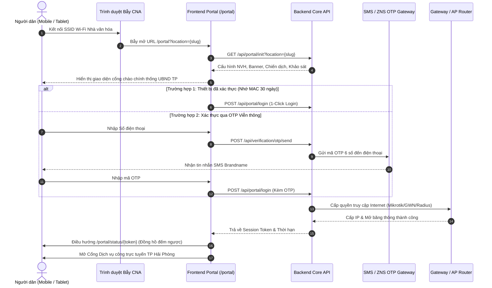
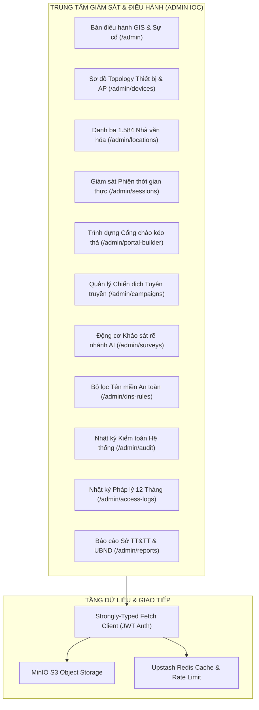
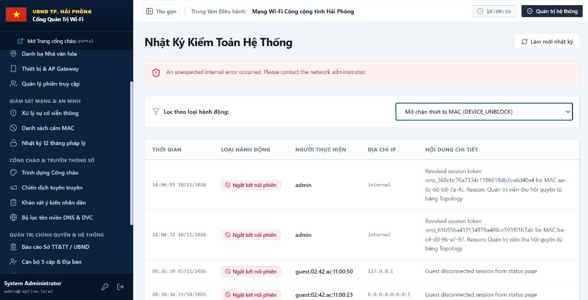
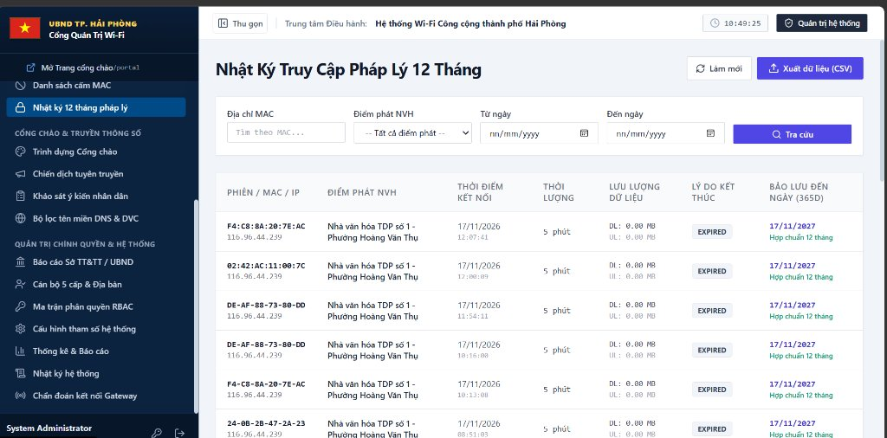
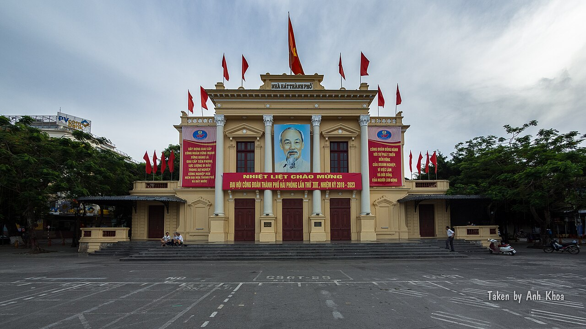

# 📱 Cổng Thông Tin & Trung Tâm Điều Hành Wi-Fi Công Cộng TP Hải Phòng — Frontend Application

[](https://react.dev/)
[](https://www.typescriptlang.org/)
[](https://vitejs.dev/)
[](https://tailwindcss.com/)
[](https://leafletjs.com/)
[](https://lucide.dev/)

Ứng dụng Frontend hiện đại, tối ưu hóa trải nghiệm di động (**Mobile-First**) phục vụ hàng triệu lượt người dân truy cập Wi-Fi miễn phí, kết hợp **Trung tâm Giám sát & Điều hành Tập trung (NOC / IOC)** dành cho Lãnh đạo UBND Thành phố Hải Phòng, Sở Thông tin & Truyền thông, cùng cán bộ quản trị địa bàn 15 quận, huyện và 1.584 Nhà văn hóa thôn, tổ dân phố.

---

## 📑 Mục Lục
1. [Tổng Quan Dự Án & Tầm Nhìn Nghiệp Vụ](#-tổng-quan-dự-án--tầm-nhìn-nghiệp-vụ)
2. [Kiến Trúc Tổng Thể & Luồng Trải Nghiệm](#-kiến-trúc-tổng-thể--luồng-trải-nghiệm)
   - [Luồng kết nối Cổng chào Captive Portal của Người dân](#luồng-kết-nối-cổng-chào-captive-portal-của-người-dân)
   - [Sơ đồ Phân hệ Trung tâm Điều hành Quản trị](#sơ-đồ-phân-hệ-trung-tâm-điều-hành-quản-trị)
3. [Giao Diện Trực Quan Thực Tế](#-giao-diện-trực-quan-thực-tế)
4. [Các Tính Năng Trọng Tâm Theo Phân Hệ](#-các-tính-năng-trọng-tâm-theo-phân-hệ)
   - [Phân hệ 1: Cổng chào Người dân (Citizen Captive Portal)](#phân-hệ-1-cổng-chào-người-dân-citizen-captive-portal)
   - [Phân hệ 2: Trung tâm Quản trị Điều hành (Admin NOC/IOC Center)](#phân-hệ-2-trung-tâm-quản-trị-điều-hành-admin-nocioc-center)
5. [Cấu Trúc Mã Nguồn (Directory Structure)](#-cấu-trúc-mã-nguồn-directory-structure)
6. [Công Nghệ & Thư Viện Sử Dụng](#-công-nghệ--thư-viện-sử-dụng)
7. [Hướng Dẫn Cài Đặt & Khởi Chạy](#-hướng-dẫn-cài-đặt--khởi-chạy)
8. [Quy Chuẩn Kiểm Thử & Đóng Gói Production](#-quy-chuẩn-kiểm-thử--đóng-gói-production)

---

## 🏛 Tổng Quan Dự Án & Tầm Nhìn Nghiệp Vụ

Dự án triển khai mạng Wi-Fi công cộng băng thông rộng phục vụ mục tiêu Chuyển đổi số toàn diện của **Ủy ban Nhân dân Thành phố Hải Phòng**:
- **Quy mô phủ sóng:** **1.584 điểm Nhà văn hóa** thôn, tổ dân phố trải dài trên **15 quận, huyện**.
- **Mục tiêu xã hội:** Tạo điều kiện thuận lợi nhất để người dân nông thôn, hải đảo tiếp cận thông tin chính sách, nộp hồ sơ **Dịch vụ công trực tuyến**, tiếp nhận cảnh báo khẩn cấp của chính quyền và tham gia khảo sát đóng góp ý kiến.
- **Tiêu chuẩn kỹ thuật:** Đáp ứng yêu cầu an toàn thông tin cấp độ 3, bẫy Captive Network Assistant (CNA) tự động không gây lỗi chứng thư số, và tuân thủ chặt chẽ Luật An ninh mạng cùng Nghị định 72/2013/NĐ-CP.

---

## 🔄 Kiến Trúc Tổng Thể & Luồng Trải Nghiệm

### Luồng kết nối Cổng chào Captive Portal của Người dân
Khi người dân kết nối vào mạng Wi-Fi `WIFI-CONG-CONG-HAI-PHONG`, điện thoại tự động kích hoạt bẫy CNA và mở trang Cổng chào:



---

### Sơ đồ Phân hệ Trung tâm Điều hành Quản trị



---

## 📸 Giao Diện Trực Quan Thực Tế

| Giao diện Nhật Ký Kiểm Toán Hệ Thống (`/admin/audit`) | Giao diện Nhật Ký Pháp Lý 12 Tháng (`/admin/access-logs`) |
| :---: | :---: |
|  |  |
| *Kiểm toán bất biến toàn bộ hành động của cán bộ, phân quyền RBAC và cấu hình gateway.* | *Bảo lưu lịch sử kết nối của người dân đủ 365 ngày phục vụ thanh tra và truy vết an ninh mạng.* |

| Cổng chào Người dân tại Nhà văn hóa | Biểu trưng Thành phố Hải Phòng |
| :---: | :---: |
|  |  |
| *Hình ảnh khuôn viên Nhà văn hóa tổ dân phố đạt chuẩn nông thôn mới / đô thị văn minh.* | *Hình nền nhận diện thương hiệu số Cổng chào chính quyền TP Hải Phòng.* |

---

## 🌟 Các Tính Năng Trọng Tâm Theo Phân Hệ

### Phân hệ 1: Cổng chào Người dân (Citizen Captive Portal)
- **Đa phương thức xác thực:**
  - **1-Click Chuyển đổi số:** Kết nối nhanh chóng dành cho bà con nhân dân.
  - **Xác thực OTP qua SMS/Zalo:** Tích hợp bộ đệm Upstash Redis chống spam tin nhắn viễn thông.
  - **Nhớ thiết bị 30 ngày (MAC Remembered):** Tự động nhận diện thiết bị thân quen, không bắt người dân nhập lại thông tin nhiều lần.
- **Tiếp cận Dịch vụ công trực tuyến:** Tự động mở liên kết Cổng Dịch vụ công Hải Phòng (`dichvucong.haiphong.gov.vn`) ngay sau khi đăng nhập thành công.
- **Báo lỗi viễn thông trực tuyến (`ReportIssueModal`):** Cho phép người dân gửi phản ánh chất lượng Wi-Fi trực tiếp về Sở TT&TT kèm ảnh chụp hiện trường.
- **Khảo sát ý kiến nhân dân:** Hiển thị bộ câu hỏi thăm dò ý kiến với cơ chế rẽ nhánh câu hỏi thông minh theo luồng logic đáp án.
- **Trang trạng thái trực tiếp (`/portal/status/:token`):** Hiển thị đồng hồ đếm ngược thời gian phiên (`HH:mm:ss`), dung lượng tải và nút chủ động ngắt kết nối.

---

### Phân hệ 2: Trung tâm Quản trị Điều hành (Admin NOC/IOC Center)
1. **Bàn điều hành GIS & Sự cố mạng (`/admin`):**
   - Bản đồ số GIS tích hợp Leaflet định vị 1.584 điểm Nhà văn hóa toàn thành phố với trạng thái màu (Xanh: Hoạt động, Đỏ: Mất tín hiệu, Vàng: Cảnh báo).
   - Hàng đợi sự cố mạng viễn thông tự động phân bổ theo cấp Quận/Huyện/Xã.
2. **Sơ đồ mạng Topology AP & Gateway (`/admin/devices`):**
   - Giám sát luồng kết nối Router GWN7001 và các Access Point Mesh.
   - Thống kê thời gian hoạt động (Uptime), CPU, RAM, nhiệt độ và tính năng **Đổi thiết bị dự phòng (Device Swap Modal)** tức thì.
3. **Danh bạ 1.584 Nhà văn hóa (`/admin/locations`):**
   - Quản lý phân cấp hành chính 3 cấp (Thành phố $\rightarrow$ Quận/Huyện $\rightarrow$ Phường/Xã $\rightarrow$ Thôn/TDP).
   - Bộ công cụ Import/Export Excel kiểm tra lỗi trùng lặp tọa độ GPS và dải IP.
4. **Trình dựng Cổng chào Live Studio (`/admin/portal-builder`):**
   - Trình thiết kế giao diện trực quan hỗ trợ mô phỏng thời gian thực trên 3 khung nhìn: **Điện thoại di động**, **Máy tính bảng** và **Màn hình máy tính**.
   - **Tạo link chia sẻ bản xem trước có chữ ký số (Preview Token):** Cán bộ có thể gửi liên kết xem trước cho Lãnh đạo duyệt giao diện mà không cần cấu hình thử nghiệm trên router thật.
   - Tải ảnh banner/hình nền trực tiếp lên hệ thống lưu trữ đối tượng **MinIO S3** tốc độ cao.
5. **Động cơ khảo sát rẽ nhánh thông minh (`/admin/surveys`):**
   - Sơ đồ trực quan luồng câu hỏi (Visual Branching Graph).
   - Thống kê tỷ lệ hài lòng của nhân dân và xuất báo cáo PDF/Excel phục vụ họp giao ban UBND.
6. **Bộ lọc tên miền DNS an toàn (`/admin/dns-rules`):**
   - Chặn các trang web cờ bạc, lừa đảo trực tuyến, mã độc bảo vệ an toàn cho người dân khi vào mạng công cộng.
7. **Nhật ký pháp lý 12 tháng (`/admin/access-logs`):**
   - Tra cứu phiên theo MAC, IP, Nhà văn hóa, thời gian; bảo lưu cố định đủ 365 ngày phục vụ Cơ quan An ninh mạng (PA05) và đoàn kiểm tra.

---

## 📁 Cấu Trúc Mã Nguồn (Directory Structure)

```
front-end/
├── public/                     # Tài nguyên tĩnh công cộng (Logo, Banners Hải Phòng)
│   └── banners/
│       ├── haiphong_city_bg.jpg
│       └── haiphong_culture_house.jpg
├── docs/images/                # Ảnh chụp giao diện thực tế phục vụ tài liệu
│   ├── nhat-ky-kiem-toan.jpg
│   └── nhat-ky-phap-ly-12-thang.jpg
├── src/
│   ├── api/                    # Tầng giao tiếp mạng & API Client
│   │   ├── client.ts           # HTTP fetch client tích hợp Bearer JWT & xử lý lỗi
│   │   ├── portalApi.ts        # API Cổng chào người dân (init, login, status, otp, issue report)
│   │   ├── adminApi.ts         # Toàn bộ API Quản trị điều hành, GIS, Báo cáo, Preview
│   │   └── authApi.ts          # Xác thực cán bộ quản trị & lưu trữ phiên
│   ├── components/             # Thư viện UI Components tái sử dụng
│   │   ├── gis/                # Bản đồ số Leaflet GIS Map
│   │   │   └── LeafletGisMap.tsx
│   │   ├── DeviceMonitoringTopology.tsx # Sơ đồ mạng Topology AP & Gateway
│   │   ├── DeviceSwapModal.tsx # Modal thay thế thiết bị hỏng dự phòng
│   │   ├── ReportIssueModal.tsx # Modal người dân báo lỗi mạng kèm ảnh
│   │   ├── AlertBanner.tsx     # Thông báo cảnh báo trạng thái
│   │   ├── Badge.tsx           # Nhãn trạng thái phiên và thiết bị
│   │   ├── Modal.tsx           # Khung hộp thoại tương tác
│   │   └── VietnamFlag.tsx     # Biểu trưng Quốc kỳ nước CHXHCN Việt Nam
│   ├── pages/
│   │   ├── portal/             # Phân hệ Cổng chào Người dân
│   │   │   ├── PortalPage.tsx  # Trang chào chính, bẫy CNA, đăng nhập, khảo sát
│   │   │   └── PortalStatusPage.tsx # Trang đếm ngược thời gian và ngắt phiên
│   │   └── admin/              # Phân hệ Trung tâm Giám sát Điều hành (Admin)
│   │       ├── AdminLayout.tsx # Khung layout chuẩn IOC, thanh điều hướng
│   │       ├── DashboardPage.tsx # Bàn điều hành GIS, sự cố & số liệu phiên
│   │       ├── LocationsPage.tsx # Quản lý danh bạ 1.584 Nhà văn hóa
│   │       ├── DevicesPage.tsx   # Quản lý thiết bị AP, Router & Topology
│   │       ├── SessionsPage.tsx  # Giám sát phiên & ngắt kết nối gateway
│   │       ├── IncidentsPage.tsx # Tiếp nhận & xử lý sự cố viễn thông
│   │       ├── PortalBuilderPage.tsx # Trình dựng Cổng chào & chia sẻ xem trước
│   │       ├── CampaignsPage.tsx # Quản lý chiến dịch tuyên truyền số
│   │       ├── SurveysPage.tsx   # Động cơ khảo sát rẽ nhánh logic
│   │       ├── DnsDomainRulesPage.tsx # Quản lý bộ lọc tên miền an toàn
│   │       ├── AccessLogsPage.tsx # Nhật ký 12 tháng pháp lý an ninh mạng
│   │       ├── AuditPage.tsx     # Nhật ký kiểm toán hệ thống bất biến
│   │       ├── GovernmentReportsPage.tsx # Xuất báo cáo gửi Sở TT&TT / UBND
│   │       └── LoginPage.tsx     # Đăng nhập Cán bộ phân quyền 5 cấp
│   ├── types/
│   │   └── models.ts           # Định nghĩa Type/Interface chuẩn DTO Backend
│   ├── App.tsx                 # Khai báo cấu hình toàn bộ Router SPA
│   ├── index.css               # Phong cách Tailwind CSS & Typography
│   └── main.tsx                # Điểm khởi chạy React DOM
├── .env                        # Cấu hình biến môi trường Frontend
├── package.json
├── tailwind.config.js
├── tsconfig.json
└── vite.config.ts              # Cấu hình Vite & Proxy chuyển tiếp API Backend
```

---

## 🛠 Công Nghệ & Thư Viện Sử Dụng

- **Ngôn ngữ & Nền tảng:** [React 18.3](https://react.dev/) + [TypeScript 5.6](https://www.typescriptlang.org/)
- **Công cụ đóng gói:** [Vite 5.4](https://vitejs.dev/) (Hot Module Replacement siêu tốc, Tree-shaking tối ưu)
- **Định tuyến:** [React Router DOM 6.26](https://reactrouter.com/) (Hỗ trợ Protected Routes và Layout lồng nhau)
- **Giao diện & Thiết kế:** [Tailwind CSS 3.4](https://tailwindcss.com/)
- **Hệ thống Biểu tượng:** [Lucide React](https://lucide.dev/) (Bộ icon đường nét tinh tế, chuẩn Enterprise)
- **Bản đồ số GIS:** [Leaflet 1.9](https://leafletjs.com/) + [React-Leaflet](https://react-leaflet.js.org/) (Bản đồ nền OpenStreetMap / CartoDB)

---

## 🚀 Hướng Dẫn Cài Đặt & Khởi Chạy

### Yêu Cầu Môi Trường
- **Node.js:** Phiên bản `>= 18.0.0` (Khuyến nghị LTS 20.x)
- **Trình quản lý gói:** `npm` `>= 9.0.0`

### Cấu Hình Biến Môi Trường (`.env`)
Tạo file `.env` tại thư mục gốc `front-end/`:
```properties
# Địa chỉ API Backend (Mặc định dùng relative proxy qua Vite khi chạy dev)
VITE_API_BASE_URL=/api
```
*(Trên môi trường Production, biến này sẽ trỏ trực tiếp đến tên miền API: `https://wifi-haiphong-api.duckdns.org/api`).*

### Các Lệnh Thực Thi
1. **Cài đặt thư viện:**
   ```powershell
   npm install
   ```

2. **Chạy máy chủ phát triển cục bộ (Local Dev):**
   ```powershell
   npm run dev
   ```
   Ứng dụng sẽ hoạt động tại:
   - Cổng chào Người dân: `http://localhost:5173/portal`
   - Cổng chào điểm mẫu: `http://localhost:5173/portal?location=nha-van-hoa-tdp-so-1-hoang-van-thu`
   - Trung tâm Quản trị Admin: `http://localhost:5173/admin`
   - *Tài khoản mặc định:* `admin` / `admin123`

---

## 🧪 Quy Chuẩn Kiểm Thử & Đóng Gói Production

Trước khi đẩy lên hệ thống quản lý mã nguồn Git hoặc đóng gói Docker Image:
1. **Kiểm tra cú pháp & Biên dịch TypeScript:**
   ```powershell
   npm.cmd run build
   ```
   Lệnh này tự động thực thi `tsc` (type check không có lỗi) và `vite build` tạo ra thư mục phân phối `dist/`.

2. **Xem trước bản đóng gói Production:**
   ```powershell
   npm.cmd run preview
   ```

---

## 📄 Bản Quyền & Giấy Phép
Dự án được phát triển và bàn giao phục vụ **Ủy Ban Nhân Dân Thành Phố Hải Phòng**. Mọi quyền sở hữu trí tuệ thuộc quyền quản lý của UBND Thành phố và Sở Thông tin & Truyền thông Hải Phòng.
